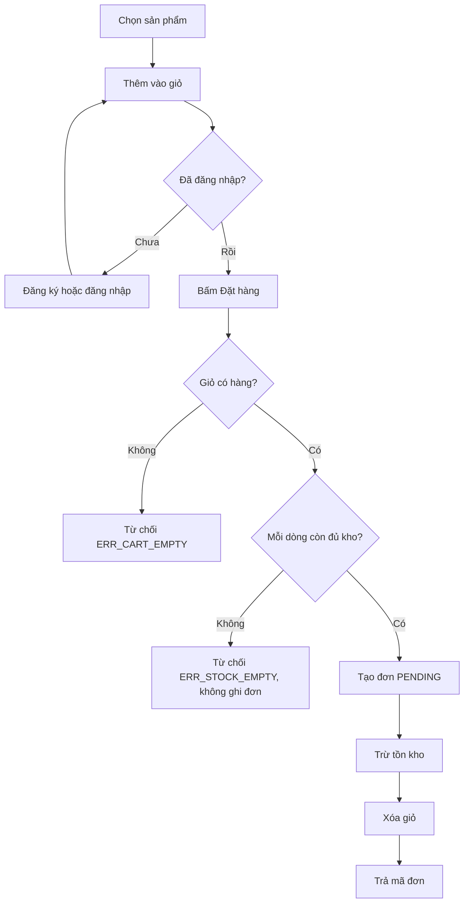
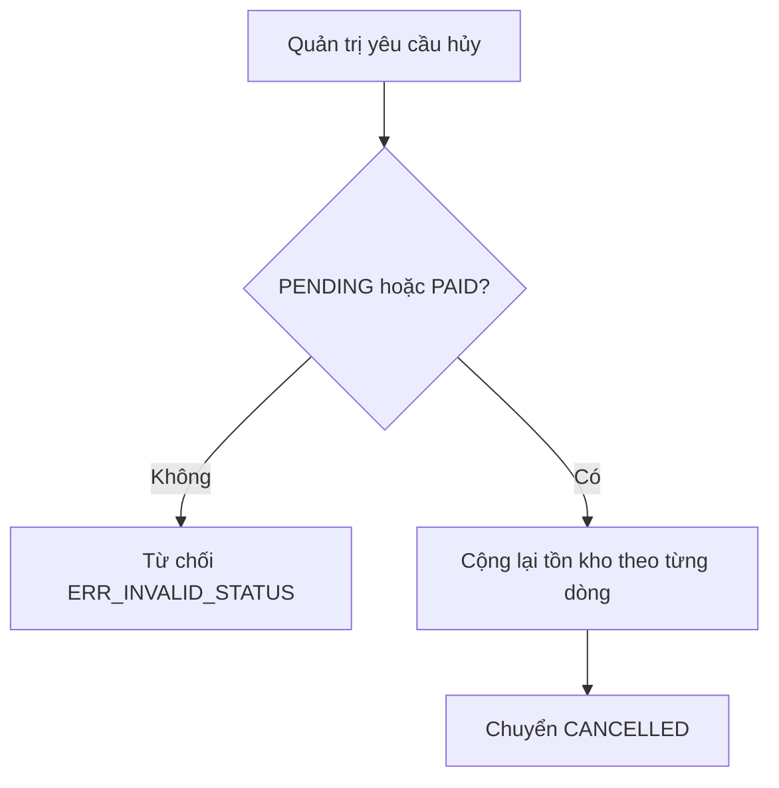
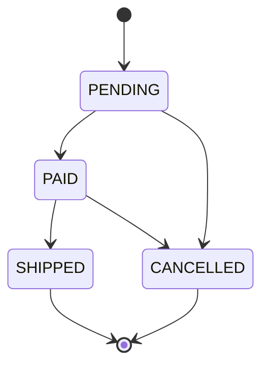

# Tài liệu nghiệp vụ — Atelier Shop

Cửa hàng bán đồ gia dụng và lifestyle. Ba module: Khách hàng, Danh mục & Sản phẩm, Giỏ hàng & Đơn hàng.

## Tác nhân

| Tác nhân | Việc được làm |
| --- | --- |
| Khách | Xem hàng, đăng ký, đăng nhập, sửa hồ sơ, giỏ hàng, đặt hàng, xem lịch sử |
| Quản trị | Danh mục, sản phẩm, tồn kho, danh sách đơn, chuyển trạng thái, hủy đơn |
| Hệ thống | Kiểm tra email/điện thoại, giữ giao dịch đặt hàng, hoàn kho khi hủy |

## Quy tắc nghiệp vụ

1. Email phải đúng định dạng. Số điện thoại là số di động Việt Nam: `0` hoặc `+84`, đầu số 3/5/7/8/9, đủ 9 chữ số phía sau.
2. Email không được trùng.
3. Sản phẩm có giá, mô tả, ảnh và số lượng tồn kho. Giá không âm. Tồn kho không âm.
4. Tìm sản phẩm theo từ khóa, danh mục, khoảng giá, có phân trang.
5. Thêm một sản phẩm đã có trong giỏ thì cộng dồn số lượng, không tạo dòng mới.
6. Đặt hàng là một giao dịch: kiểm tra tồn kho → tính tổng tiền → tạo đơn `PENDING` → trừ tồn kho → xóa giỏ. Hết hàng thì không tạo đơn và không trừ kho.
7. Đơn lưu tên và đơn giá tại thời điểm mua. Đổi giá sau đó không sửa đơn cũ.
8. Trạng thái:
   - `PENDING` → `PAID` hoặc `CANCELLED`
   - `PAID` → `SHIPPED` hoặc `CANCELLED`
   - `SHIPPED` và `CANCELLED` không đổi tiếp
9. Hủy từ `PENDING` hoặc `PAID` thì cộng lại tồn kho theo từng dòng. Không hủy đơn đã giao.
10. Xóa danh mục khi còn sản phẩm, hoặc xóa sản phẩm đã nằm trong đơn, thì từ chối.

## User stories

### Khách hàng

1. Là khách, tôi muốn đăng ký bằng họ tên, email, số điện thoại và mật khẩu để có tài khoản.
   - Email sai hoặc số điện thoại sai thì hệ thống từ chối và nói rõ trường nào lỗi.
   - Email đã tồn tại thì không tạo tài khoản thứ hai.
2. Là khách, tôi muốn đăng nhập bằng email và mật khẩu để nhận phiên làm việc.
   - Sai mật khẩu thì không cấp phiên.
3. Là khách, tôi muốn sửa họ tên, số điện thoại và địa chỉ. Email giữ nguyên.
4. Là khách, tôi muốn xem các đơn của chính mình, mới nhất trước.

### Danh mục và sản phẩm

5. Là khách, tôi muốn xem danh sách sản phẩm theo trang để không phải tải toàn bộ catalog.
6. Là khách, tôi muốn lọc theo danh mục, từ khóa và khoảng giá để tìm đúng món.
7. Là khách, tôi muốn mở trang chi tiết để xem mô tả, giá và tồn kho trước khi cho vào giỏ.
8. Là quản trị, tôi muốn tạo, sửa, xóa danh mục và sản phẩm.
9. Là quản trị, tôi muốn sửa số lượng tồn kho khi nhập hàng.

### Giỏ hàng và đơn hàng

10. Là khách đã đăng nhập, tôi muốn thêm, đổi số lượng và xóa dòng trong giỏ.
11. Là khách, tôi muốn đặt hàng từ giỏ và nhận mã đơn khi thành công.
    - Giỏ trống thì không tạo đơn.
    - Một dòng vượt tồn kho thì cả đơn thất bại, tồn kho giữ nguyên.
12. Là quản trị, tôi muốn xem mọi đơn và chuyển trạng thái đúng chiều cho phép.
13. Là quản trị, tôi muốn hủy đơn chưa giao và thấy tồn kho được hoàn.

## Luồng đặt hàng

## Luồng hủy đơn

## Máy trạng thái

## Ánh xạ ra API

| Việc | Endpoint |
| --- | --- |
| Đăng ký | `POST /api/v1/customers` |
| Đăng nhập | `POST /api/v1/sessions` |
| Hồ sơ | `GET/PUT /api/v1/customers/{customerId}` |
| Lịch sử đơn | `GET /api/v1/customers/{customerId}/orders` |
| Danh mục | `/api/v1/categories` |
| Sản phẩm | `/api/v1/products` |
| Giỏ | `/api/v1/customers/{customerId}/cart` |
| Đặt hàng | `POST /api/v1/orders` |
| Quản trị đơn | `GET /api/v1/orders`, `PATCH /api/v1/orders/{orderId}` |

Nguồn sự thật của hợp đồng là `api/shop-api.yaml`.
